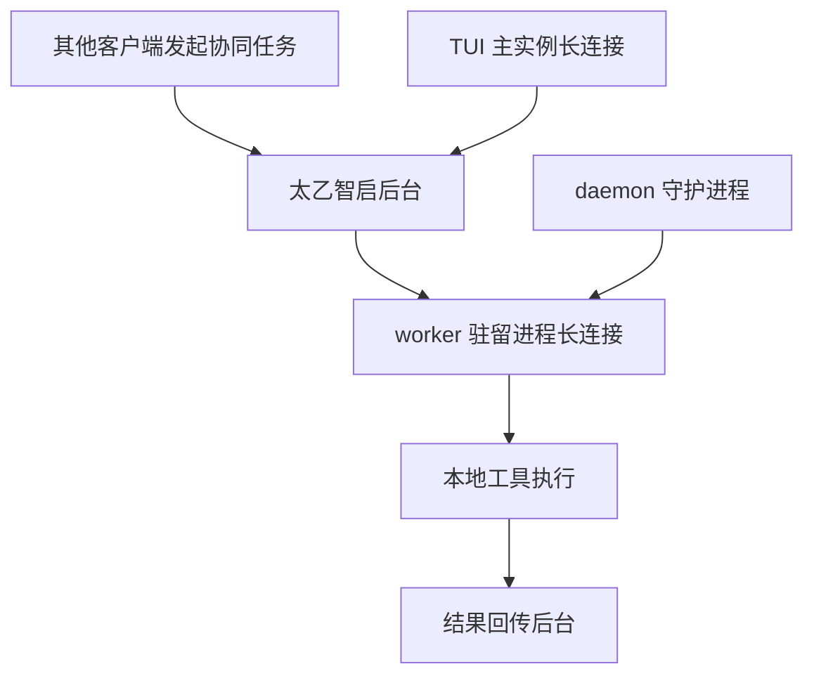

# 协同与常驻执行

除了前台交互，CLI 还能以常驻进程形式接收并执行协同任务：其他设备（桌面端、另一台 CLI）发起的任务可以调度到本机执行。这套能力由 worker 驻留进程、daemon 守护进程托管与主实例长连接三部分组成。

## 整体结构



## worker — 协同驻留进程

```bash
taiyiflow-cli worker [--max-concurrency N] [--recent-limit N] \
                     [--ping-seconds N] [--reconnect-seconds N]
```

| 参数 | 默认 | 说明 |
| --- | --- | --- |
| `--max-concurrency` | 4 | 允许同时执行的子任务数 |
| `--recent-limit` | 20 | 连接就绪后补抓的最近任务条数 |
| `--ping-seconds` | 45 | 在线状态保活心跳秒数 |
| `--reconnect-seconds` | 3 | 长连接断开后的重连间隔秒数 |

行为要点：

- 启动时确保客户端身份与登录态，随后建立长连接等待任务调度；
- 连接就绪后补抓最近任务，避免离线期间漏单；
- 收到 `SIGTERM` / `SIGINT` 时优雅退出：停止接受新任务，等待当前任务完成后退出；
- worker 没有会话级覆盖，子任务继承全局配置中的思考模式与联网搜索设定。

## daemon — 守护进程托管

手工运行 `worker` 需要保持终端常驻；`daemon` 把它交给操作系统托管：

```bash
taiyiflow-cli daemon install     # 安装并启动
taiyiflow-cli daemon status      # 查看运行状态
taiyiflow-cli daemon stop        # 停止（不卸载）
taiyiflow-cli daemon start       # 启动已安装的守护进程
taiyiflow-cli daemon uninstall   # 停止并卸载
```

| 平台 | 托管方式 | 标识 |
| --- | --- | --- |
| macOS | launchd（用户级 LaunchAgent） | `cn.snz1dp.taiyiflow-cli.worker` |
| Linux | systemd（用户级 user service） | `taiyiflow-cli-worker` |

日志输出到 `~/.snz1dp/logs/`。Windows 暂不支持守护进程安装。

### 更新流程

```bash
taiyiflow-cli daemon stop     # 停止旧进程
# <替换二进制文件>
taiyiflow-cli daemon start    # 启动新进程
```

## 主实例长连接

交互模式（TUI）启动时，正式用户会额外建立一条主实例长连接（角色 `primary_cli`），用于接收服务端派发的任务：

- 事件类型：`connection.ready`、`connection.ping` / `connection.pong`、`session.update`、`primary_task.dispatch` 等；
- 收到 `primary_task.dispatch` 时，把任务（prompt + session_id）派发到当前交互会话；
- 断线后按固定间隔重连（默认 3 秒），心跳间隔默认 45 秒；
- 非正式用户（`public`  scope）跳过远端任务调度连接，启动时会提示。

## collaboration — 协同任务查询

```bash
taiyiflow-cli collaboration list [--status <状态>]  # 协同任务列表
taiyiflow-cli collaboration get <task_id>           # 任务详情
taiyiflow-cli collaboration online                  # 当前在线的桌面/CLI 客户端
```

`online` 用于确认目标设备是否在线，再决定把任务调度到哪台设备。

## 定时任务

定时任务由服务端调度，到点后向关联客户端发起执行（请求模式可为 agent / ask / plan / command）：

```bash
taiyiflow-cli schedule create --name "每日构建" --cron "0 9 * * *" \
  --prompt "执行项目构建并报告结果"
taiyiflow-cli schedule list
taiyiflow-cli schedule runs <schedule-id>
```

完整参数见[命令参考](/commands)。`command` 模式直接执行 shell 命令，其余模式走智能体任务链路。

## 跨会话记忆

跨会话记忆把历史会话中的稳定事实沉淀为可复用摘要，供后续会话检索：

```bash
taiyiflow-cli memory status                 # 查看整合状态
taiyiflow-cli memory list limit=20          # 查看记忆记录
taiyiflow-cli memory trigger hours=6 sessions=3 execute=off   # 预览整合
taiyiflow-cli memory trigger execute=on     # 执行整合
```

- 总开关：`cross_session_memory_enabled`（默认开启）；
- 单次任务覆盖：`task --cross-session-memory-enabled`；
- TUI 内等价入口：`/memory`。

## 典型部署

一台常驻开发机：

```bash
taiyiflow-cli login qr          # 扫码登录
taiyiflow-cli daemon install    # 托管 worker，开机自动接收协同任务
taiyiflow-cli daemon status     # 确认运行中
```

之后在桌面端或另一台 CLI 上发起任务时，即可把执行调度到这台机器。