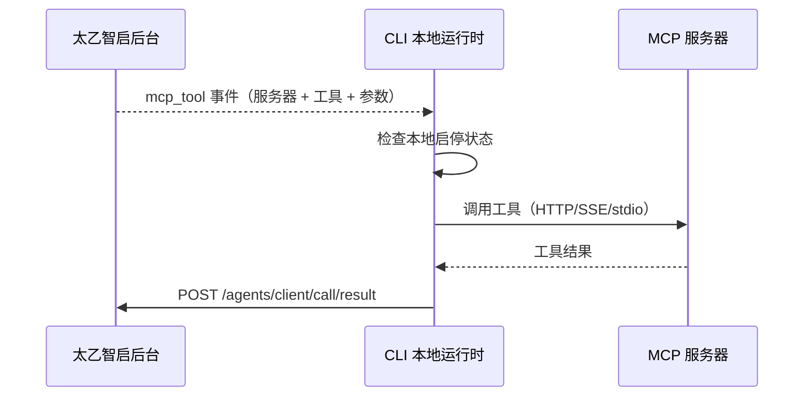

# MCP 接入

模型上下文协议（Model Context Protocol，MCP）让智能体调用外部工具服务器。太乙智启的 MCP 服务器按智能体供应：服务端维护服务器注册表，CLI 负责本地启停与自建服务器管理，工具调用经后台流式接口下发（`mcp_tool` 事件）并在本地执行。

## 服务器来源

- **系统内置服务器**（`is_system=true`）：由平台预置，不可被禁用或删除；
- **可选加载服务器**：平台提供、按需启用；
- **用户自建服务器**（“我的服务”）：你自己添加的服务器，可编辑、删除。

```bash
taiyiflow-cli mcp list     # 列出当前智能体的 MCP 服务器（含分组与启用状态）
taiyiflow-cli mcp status   # 查看本地 MCP 禁用配置
```

## 添加自建服务器

```bash
taiyiflow-cli mcp add --name <名称> --url <地址> [--type <类型>] [选项]
```

| 选项 | 说明 |
| --- | --- |
| `--name` | 服务器名称（必填，仅英文、数字、下划线、连字符） |
| `--url` | 服务器地址（必填） |
| `--type` | `streamable_http`（默认）/ `sse` / `stdio` / `other` |
| `--description` | 服务器描述 |
| `--default-enabled` | 默认启用状态（默认 `true`）；设为 `false` 时其他客户端首次看到该服务默认禁用 |
| `--pass-user-identity` | 调用时传递用户登录会话令牌（默认 `false`），仅 sse / streamable_http 生效 |
| `--agent` | 指定智能体 ID（默认当前默认智能体） |

三种接入类型：

```bash
# Streamable HTTP
taiyiflow-cli mcp add --name my-api --url https://mcp.example.com/mcp --type streamable_http

# SSE
taiyiflow-cli mcp add --name my-sse --url https://mcp.example.com/sse --type sse

# Stdio（本地进程，仅桌面端可用）
taiyiflow-cli mcp add --name local-tool --url "stdio://npx -y @some/mcp-server" --type stdio
```

::: warning Stdio 限制
Stdio 类型通过本地子进程运行 MCP 服务器，仅桌面端（本机 CLI）可用；Web 模式下添加 stdio 服务器会报错。
:::

## 编辑与删除

```bash
taiyiflow-cli mcp edit <服务器ID> [--name ...] [--url ...] [--type ...] \
                                [--description ...] [--default-enabled ...] \
                                [--pass-user-identity ...] [--agent ...]
taiyiflow-cli mcp remove <服务器ID>
```

仅用户自建服务器可编辑/删除；系统内置与可选服务器不可修改。删除后不可恢复。

## 本地启停

启用/禁用是**本地行为**，保存在 `~/.snz1dp/config/mcp.json`，与太乙智启桌面端（taiyiflow-chatui）共享同一配置文件：

```bash
taiyiflow-cli mcp enable <服务器ID>                # 启用服务器
taiyiflow-cli mcp disable <服务器ID>               # 禁用服务器
taiyiflow-cli mcp enable-tool <服务器ID> <工具名>   # 启用单个工具
taiyiflow-cli mcp disable-tool <服务器ID> <工具名>  # 禁用单个工具
```

配置文件结构：

```json
{
  "disabled_server_ids": ["user-1"],
  "disabled_tool_keys": ["sys-1:search_web"]
}
```

- 系统内置服务器（`is_system=true`）不可被禁用；
- 工具级禁用键格式为 `<服务器ID>:<工具名>`；
- 在桌面端做的启停修改，CLI 下次读取时同样生效，反之亦然。

## 智能体侧的 MCP 管理工具

智能体在运行中也可以管理 MCP（见[本地工具](/tools)）：`mcp_list_servers`、`mcp_list_tools`、`mcp_add_server`、`mcp_edit_server`、`mcp_delete_server`、`mcp_toggle_server`、`mcp_toggle_tool`。这些工具遵循与命令行相同的约束（系统内置不可禁用、仅自建可编辑删除）。

## 工具调用链路



被本地禁用的服务器或工具不会执行；`pass_user_identity` 开启时，HTTP 类调用会携带当前用户会话令牌（Bearer）。