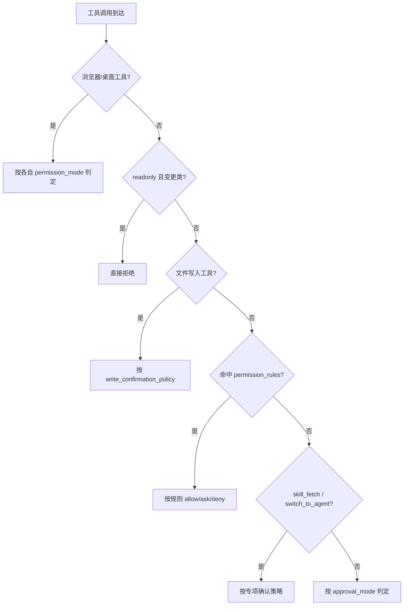

# 安全与权限

CLI 的安全模型由多层组成：审批模式决定“要不要问”，权限规则决定“按什么规则问”，Shell 沙盒决定“命令能碰到什么”，外部资源访问策略决定“能不能走出工作目录”。各层独立配置、叠加生效。

## 审批模式（approval_mode）

全局命令执行模式，三档：

| 取值 | 行为 |
| --- | --- |
| `confirm`（默认） | 变更类工具执行前弹窗确认 |
| `auto` | 变更类工具自动执行，不弹窗 |
| `readonly` | 只读模式，变更类工具直接拒绝 |

```bash
taiyiflow-cli config set approval_mode confirm
```

TUI 中可用 `/permissions set approval <confirm|auto|readonly>` 即时修改。

## 权限规则（permission_rules）

在审批模式之上叠加细粒度规则，支持两种维度：

- **工具级**：对指定工具名设置动作；
- **命令前缀级**：对 `shell_exec` 的命令前缀设置动作。

动作三档：`allow`（直接放行）、`ask`（强制确认）、`deny`（直接拒绝）。

```text
/permissions show                                    查看当前权限设置与规则列表
/permissions rule add tool <tool> <allow|ask|deny>   添加工具级规则
/permissions rule add shell <prefix> <allow|ask|deny> 添加命令前缀级规则
/permissions rule remove <序号>                       删除规则
```

示例：

```text
/permissions rule add shell "git status" allow     # git status 免确认
/permissions rule add shell "rm " deny             # 拒绝 rm 开头的命令
/permissions rule add tool write_file ask          # 写文件强制确认
```

规则持久化在配置文件的 `permission_rules` 列表：

```yaml
permission_rules:
  - action: allow
    command_prefix: git status
  - action: deny
    command_prefix: "rm "
  - action: ask
    tool_name: write_file
```

命中规则时按规则动作执行，优先于全局审批模式；`deny` 命中会返回 `PERMISSION_DENIED` 错误给智能体。

## Shell 沙盒（shell_sandbox_mode）

`shell_exec` 在操作系统级沙盒中执行，限制命令可访问的文件系统范围：

| 平台 | 沙盒实现 |
| --- | --- |
| macOS | `sandbox-exec`（Seatbelt） |
| Linux | `bwrap`（bubblewrap） |
| Windows | 无操作系统级沙盒，回退为直接执行（仍受危险命令守卫约束） |

三种模式：

| 取值 | 行为 |
| --- | --- |
| `auto`（默认） | 优先沙盒执行；平台工具不可用时静默回退为无沙盒 |
| `enforce` | 强制沙盒；平台工具不可用时报错，不执行 |
| `off` | 关闭沙盒 |

```bash
taiyiflow-cli config set shell_sandbox_mode enforce
```

沙盒允许访问的范围：

- 当前工作目录（始终可读写）；
- 系统临时目录；
- `sandbox_roots` 配置的额外目录；
- 技能目录等运行时必需路径。

```text
/permissions set sandbox <confirm|deny|allow>   外部资源访问策略（见下节）
/permissions set roots <a,b>                    设置额外允许目录
/permissions clear roots                        清空额外允许目录
```

::: warning enforce 与 auto 的取舍
`auto` 在缺少沙盒工具的环境中会降级为无沙盒执行，适合兼容性优先的场景；对安全要求高的环境应使用 `enforce`，确保“要么沙盒、要么不执行”。
:::

## 外部资源访问策略

控制工具能否访问工作目录之外的资源（`external_resource_access_policy`，兼容旧键 `sandbox_escape_policy`）：

| 取值 | 行为 |
| --- | --- |
| `confirm`（默认） | 访问工作目录外资源前确认 |
| `deny` | 拒绝访问工作目录外资源 |
| `allow` | 允许访问工作目录外资源 |

```bash
# 持久化默认策略
taiyiflow-cli config set external_resource_access_policy deny

# 单次任务临时覆盖
taiyiflow-cli task --external-resource-access-policy confirm "读取工作目录外的参考文件"
```

`sandbox_roots` 中列出的目录视为已授权的外部资源。

## 专项确认策略

| 配置项 | 默认 | 说明 |
| --- | --- | --- |
| `write_confirmation_policy` | `confirm` | 文件写入审查；`direct` 时 `write_file` / `file_edit` 直接执行 |
| `skill_review_policy` | `confirm` | `skill_fetch` 装载技能前审查；`ignore` 跳过 |
| `mode_switch_confirmation_policy` | `confirm` | `switch_to_agent` 模式切换确认；`skip` 跳过 |
| `tool_confirm_timeout_seconds` | `120` | 确认弹窗倒计时（0 表示禁止倒计时，范围 0–300） |

## 浏览器与桌面审批

浏览器与桌面工具族有独立的权限模式（`browser_permission_mode`、`computer_permission_mode`），取值 `ask` / `follow_a_plan` / `skip_all_permission_checks`，独立于全局审批模式。详见[浏览器与桌面自动化](/browser-computer)。

## 判定顺序

一次工具调用执行前的完整判定链（简化）：



## 审计

开启 `audit_enabled` 后，工具调用审计日志写入 `~/.snz1dp/logs/audit.log`：

```bash
taiyiflow-cli config set audit_enabled true
```

## 凭据安全

- 访问令牌与持久令牌以 `enc:v1:` 前缀加密存储在配置文件中；
- `get_sso_token` 工具获取的令牌仅用于认证请求，不会出现在回答或生成内容中；
- 登录态清理用 `taiyiflow-cli login logout`，不要手工编辑加密字段。