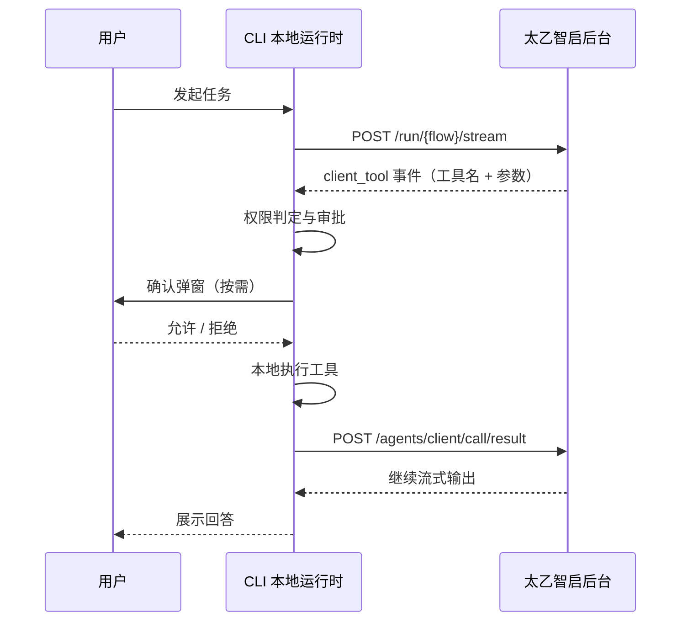

# 本地工具

智能体在太乙智启后台运行，但工具调用落到你的本机执行。CLI 把本地能力注册为服务器名 `local` 下的客户端工具：后台流式接口下发 `client_tool` 事件，CLI 在本地执行（必要时先请求审批），再把结果回传后台，智能体据此继续推理。

## 工具总览

### 文件与搜索

| 工具 | 说明 |
| --- | --- |
| `read_file` | 读取文本文件，支持按行读取、编码自动转换（GBK/Big5/UTF-16 等）与 UTF-8 安全截断 |
| `write_file` | 写入文本文件，支持 create / overwrite / append 与原子写入 |
| `file_edit` | 基于 old_string / new_string 的细粒度编辑，自动适配换行符，冲突时返回重试指引 |
| `glob_files` | 按 glob 模式枚举文件或目录 |
| `search_files` | 在工作目录内搜索文本，支持正则、glob 过滤、包含/排除模式与分页 |
| `lsp_query` | 语言服务查询（代码符号等） |

### 命令与后台任务

| 工具 | 说明 |
| --- | --- |
| `shell_exec` | 执行本地 Shell 命令；优先结构化 `command + args`，需要管道/重定向时用 `rawCommand`；支持前台、后台任务、stdin、超时与工作目录指定 |
| `task_list` | 列出本地后台任务 |
| `task_output` | 读取后台任务状态与输出摘要 |
| `terminal_capture` | 读取后台任务的终端视角输出（stdout / stderr） |
| `task_stop` | 停止运行中的后台任务 |
| `task_delete` | 删除已结束的后台任务及其输出 |
| `task_cleanup` | 批量清理所有已结束的后台任务 |

`shell_exec` 在 macOS / Linux 上默认进入沙盒执行，详见[安全与权限](/security)。

### 任务编排

| 工具 | 说明 |
| --- | --- |
| `todo_write` | 覆盖写入当前会话待办清单，驱动 TUI 右侧待办栏 |
| `run_subtask` | 创建并执行子智能体任务，支持批量并行（`max_parallelism` 默认 3，上限 32） |
| `ask_user` | 向用户收集澄清信息或执行前确认，支持文本/选择题与图片展示 |
| `switch_to_agent` | 从 ask / plan 模式切换到 agent 执行模式（默认需确认） |

### 多模态与文档

| 工具 | 说明 |
| --- | --- |
| `image_understanding` | 上传本地图像到服务端图像理解流程，返回文本结果 |
| `document_unstructured` | 上传本地非图片文件（音视频、PDF、Office 等）到服务端文档结构化流程 |

`document_unstructured` 支持的扩展名由 `doc_unstructured_exts` 配置控制；图片理解默认走 `image_understanding`。

### 技能管理

| 工具 | 说明 |
| --- | --- |
| `skill_fetch` | 按名称装载本地技能，返回可立即执行的技能提示内容（默认需审查确认） |
| `skill_create` | 创建或覆盖本地技能包（写入 SKILL.md） |
| `skill_upload` | 将本地技能上传到服务端 |
| `skill_delete` | 删除本地文件系统技能（不能删除内置 bundled 技能） |

详见[技能（Skill）](/skills)。

### MCP 管理

| 工具 | 说明 |
| --- | --- |
| `mcp_list_servers` | 列出当前用户可访问的 MCP 服务器及状态 |
| `mcp_list_tools` | 列出指定服务器下的工具及启用状态 |
| `mcp_add_server` | 添加用户自建 MCP 服务器 |
| `mcp_edit_server` | 编辑用户自建 MCP 服务器 |
| `mcp_delete_server` | 删除用户自建 MCP 服务器 |
| `mcp_toggle_server` | 启用/禁用 MCP 服务器（本地） |
| `mcp_toggle_tool` | 启用/禁用单个工具（本地） |

详见 [MCP 接入](/mcp)。

### 定时任务

| 工具 | 说明 |
| --- | --- |
| `schedule_list` | 查询定时任务列表（只读） |
| `schedule_runs` | 查询执行历史（只读） |
| `schedule_create` | 创建定时任务 |
| `schedule_update` | 更新定时任务 |
| `schedule_delete` | 删除定时任务 |
| `schedule_enable` / `schedule_disable` | 启用/停用定时任务 |

### 认证辅助

| 工具 | 说明 |
| --- | --- |
| `get_sso_token` | 获取当前会话令牌，用于服务端认证（令牌敏感，不会出现在回答中） |

### 浏览器与桌面

浏览器自动化工具（`taiyiflow-in-chrome__*`）与桌面操作工具（`taiyiflow-computer__*`）是两组独立的工具族，详见[浏览器与桌面自动化](/browser-computer)。

## 请求模式与工具可见性

不同请求模式下暴露给智能体的工具集合不同：

- **agent 模式**：暴露全部本地工具；
- **ask / plan 模式**：只暴露只读与辅助工具——文件读取与搜索（`read_file`、`glob_files`、`search_files`、`lsp_query`）、后台任务查看（`task_list`、`task_output`、`terminal_capture`）、技能管理、MCP 管理、定时任务查询（`schedule_list`、`schedule_runs`）、`ask_user`、`switch_to_agent`、`get_sso_token`，以及浏览器/桌面的只读工具（标签页上下文、读取文本、读取控制台、显示器/窗口上下文、截图）。

变更类操作（写文件、执行命令、点击输入等）只在 agent 模式下可用。`switch_to_agent` 让智能体在 ask / plan 模式中征得同意后切换到执行模式。

## 审批与权限

工具执行前的判定顺序（简化）：

1. 浏览器/桌面工具按各自的 `permission_mode` 判定；
2. `readonly` 审批模式下，变更类工具直接拒绝；
3. 文件写入工具按 `write_confirmation_policy` 判定；
4. 命中 `permission_rules` 权限规则时按规则动作（allow / ask / deny）执行；
5. `skill_fetch` 按 `skill_review_policy`、`switch_to_agent` 按 `mode_switch_confirmation_policy` 判定；
6. 其余变更类工具按 `approval_mode` 判定（confirm 弹窗确认，auto 直接执行）。

详见[安全与权限](/security)。

## 结果回传

工具执行结果通过 `POST /agents/client/call/result` 回传后台，携带会话与调用标识；后台据此继续流式推理。执行失败时回传结构化错误（如 `PERMISSION_DENIED`），智能体会据此调整策略或向用户说明。